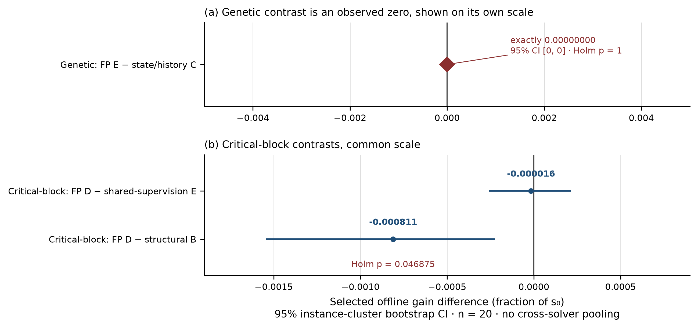

# Do Fixed-Point Predictions Improve Heuristic Action Selection? Decision Sufficiency and Two-Solver Evidence from Job Shop Scheduling

**Chinese title:** 固定点预测能否改善启发式动作选择？作业车间调度中的决策充分性与双求解器实证研究

**Authors, affiliations and corresponding author:** [AUTHOR_INPUT_REQUIRED: names, affiliations, contact details and available ORCIDs.]

## Abstract

Fixed-point representations of search dynamics may predict state changes without improving heuristic decisions. We examine this distinction in job shop scheduling using a genetic/memetic implementation and an independently written critical-block tabu-search implementation. Historical evidence contains 109,440 isolated action branches on 48 benchmark instances. A subsequent locally frozen confirmation evaluates both implementations on 20 newly generated instances with 20 paired trajectory seeds each, producing 84,000 further branches. We separate transition error, improvement-event prediction, within-state ranking and independently evaluated action return. A standard conditional-information argument explains why a deterministic transformation of fully observed state adds no ideal decision information, while allowing finite-sample inductive-bias effects. In the genetic stack, fixed-point features improve average precision but leave selected reward unchanged on the new instances. In the critical-block stack, action-conditioned predictions improve on persistence, yet fixed-point decision features lose 0.000811 normalized reward relative to structural state (95% interval [−0.001544, −0.000223]; Holm-adjusted p=0.046875), with losses concentrated at the smallest size. They do not outperform a shared-supervision NoFP comparator. Retrospective two-repeat winners lose their apparent advantage on independent repeats in both search implementations. A matched-window intervention also reverses the aggregate LS/VND ordering in the genetic stack. These conditional findings support separating predictive fit, observed information and decision utility; they establish neither universal fixed-point failure nor an effective new online agent.

**Keywords:** job shop scheduling; fixed-point representation; heuristic action selection; decision sufficiency; empirical evaluation; tabu search.

## 1. Introduction

A search controller must choose an action whose consequences are useful, whereas a state predictor is rewarded for describing what happens next. The objectives can disagree. An action may change a population substantially without finding a better schedule; a small incumbent replacement may improve the objective while barely changing population statistics. A representation that separates these transitions need not identify the best action. This paper studies that distinction for empirical fixed-point (FP) representations in classical job shop scheduling (JSSP).

The FP representation considered here is a residual of a learned affine state-transition map. Once a map is trained, its residual is a deterministic function of the observed state and the map. It is neither a new sensor nor a certificate that a schedule is locally optimal. It can nevertheless help a restricted predictor: it changes the functional form, brings transition supervision into feature construction, and may supply a useful inductive bias. These possibilities demand controls that distinguish an informative additional observation from an advantageous transformation of existing observations.

Our starting evidence is a completed, unsuccessful attempt to establish an independent FP action-selection benefit. We preserve its negative results and numerical convergence checks. We then add a genuinely independent search implementation and a finite new confirmation, rather than modifying the residual, searching reliability thresholds or developing another candidate FP-Agent. The second implementation represents schedules by complete machine orders and applies critical-block descent or tabu moves. Its graph decoder and operators do not call the genetic implementation. We use each solver's native actions and observables and analyze their effects separately.

The contribution is empirical and conditional. First, we organize prediction and decision results using the standard distinction between observation information and finite-class representation. Second, we measure the fate of an apparent sample-winner advantage under independent action repetitions and explicitly contrast it with a policy trained on other instances. Third, we test whether these mechanisms recur across two independent code paths and report where they do not. Fourth, we deliver saved states, actual endpoints, frozen models and independent verification scripts. The information argument, the existence of sampling optimism and the principles of controlled comparison are established ideas, not new theorems.

The results do not support an effective new online FP controller. That conclusion does not imply equivalence of all feature sets, universal FP failure, or that negative branch counts alone constitute a publication contribution. Our narrower finding is that in these interventions, better transition prediction or event ranking did not establish incremental selected-action value over reasonable NoFP controls. The action-window reversal and independent-repeat results identify concrete ways that an apparent opportunity for selection can be overstated.

## 2. Related Work

### 2.1 Empirical dynamics and fixed-point interpretation

Dynamic mode decomposition estimates approximate linear operators from snapshots, and DMD with control separates recorded actuation from autonomous evolution (Tu et al. 2014; Proctor et al. 2016). Finite-dimensional linear representations of nonlinear dynamics require substantive assumptions (Brunton et al. 2016). These works motivate recording actions and observation spans; they do not make separate affine search maps a new identification method. Our four statistics are not proved Markovian or invariant observables. No contraction, global convergence or scheduling-optimality guarantee is inferred from a small residual.

### 2.2 Operator selection, prediction and decisions

Adaptive operator selection distinguishes credit assignment from selection rules and includes nonstationary bandit approaches (Da Costa et al. 2008; Fialho et al. 2009; Pei et al. 2025). TRACE learns improvement-event classifiers from historical search traces for CVRP neighborhood selection (Kalatzantonakis et al. 2025). Offline probability scoring and history-conditioned operator choice are therefore established mechanisms. Decision-focused learning likewise recognizes that prediction accuracy and downstream decision quality can diverge (Wilder et al. 2019; Elmachtoub and Grigas 2022). Ranking formulations and surveys further develop this distinction (Mandi et al. 2022, 2024). We do not propose a new decision-focused loss. We evaluate event-probability and direct expected-gain scorers without selecting the target from test performance.

### 2.3 Scheduling representations and landscape evidence

Learning dispatch rules, local-search controllers and improvement moves is well established in JSSP and related problems (Zhang et al. 2020; Falkner et al. 2023; Zhang et al. 2024). Memory-based improvement heuristics address flexible JSSP (Wang et al. 2025), while Oh et al. (2026) study state design from dynamics and value-prediction perspectives. Their decision tasks and richer structures differ from our aggregate-state interventions; none validates our restricted representation by implication.

Tsogbetse et al. (2024) are particularly close prior art. They study 15 encoding–neighborhood pairs using 242 classical and 2,500 generated instances and find that customary landscape metrics do not reliably recommend tabu-search performance. Rosa and Pereira (2024) use landscape characteristics for intensification. Thus the general caution that landscape description need not guide an effective decision is not our discovery. Our narrower distinction is saved-state, action-conditioned affine FP representation; shared-history and shared-transition-supervision controls; independent evaluation of noisy action winners; and a two-implementation diagnostic with native actions. The differences table in the supplement records both overlap and scope. Our instance breadth is smaller than Tsogbetse et al.'s, and our study does not replace theirs.

Controlled algorithm-behavior work, such as structural-bias studies, provides another empirical precedent (Piotrowski and Napiorkowski 2016). Statistical comparison across datasets motivates instance-level paired reporting (Demšar 2006), but neither this precedent nor a corrected p-value proves scientific novelty. We claim measured boundaries of a particular representation, not a first general methodology.

## 3. Research Questions and Hypotheses

RQ1 asks whether action-conditioned affine dynamics predict the next observed state more accurately than a pooled map and identity prediction. RQ2 asks whether FP representations add predictive and decision value beyond the same ordinary/structural/history observations and transition supervision. RQ3 asks whether their predictions select higher-return native actions, robustly to independent repetitions and declared action windows.

Table 1 states the hypotheses, variables and possible disconfirming evidence. They are research questions rather than assumptions that FP must succeed. H2 is a known conditional-information fact. H1 is evaluated through concrete counterexamples to an inference from prediction improvement to action gain; a finite study cannot establish a universal law about the two.

**Table 1. Hypotheses and scope.**

| Hypothesis | Observed comparison | Potential counterevidence / limit |
|---|---|---|
| H1: prediction need not imply decision value | Transition error/AP/Brier versus within-state order and selected return | A representation can improve both; no universal dissociation is claimed |
| H2: deterministic FP adds no ideal observation information | Full-state controls conditional on the fitted maps | Antecedent fails if FP uses omitted history or other new measurements |
| H3: noise and noisy winners explain part of mismatch | Split-repeat winner return, paired reward variation, tie rates | A stable independent winner advantage would weaken the noise account; representation loss is not identified |
| H4: mechanisms may recur across solvers | Separate native-action analyses in two independent implementations | Different transition or decision findings delimit transfer |
| H5: window changes action efficacy | Matched atomic versus 480-request LS/VND gains | Stable direction across the tested intervention would fail to support a reversal |

## 4. Decision Sufficiency and FP Modeling

### 4.1 Decision value and what the data identify

Let S be the complete state required by the intervention, including current/incumbent schedules or population, relevant solver memory, the normalization s0, decision position, and actual observation history. The independently sampled future branch random stream is exogenous randomness, not an observed input in S. A native action a starts from a copy of S and consumes that independently assigned stream. Its nonnegative reward is the decrease in best feasible makespan divided by the initial trajectory makespan s0. The action and its execution window are part of the intervention definition. Write

EQUATION: R_a = (C_best(S) − C_best(S_a)) / s0;     μ_a(s) = E[R_a | S=s].

For an observed representation Z=φ(S), define the best conditional value over a finite action set:

EQUATION: V(Z) = E[max_a E[R_a | Z]].

If a policy is measurable in Z, its expected return cannot exceed V(Z). This is an ideal information benchmark, not the return of a particular fitted ridge or logistic policy. With a full state S and a coarser Z, conditional Jensen gives V(S)≥V(Z). Neither quantity nor their difference is identified by our finite collection of five repeats per new state/action. We report learned-policy returns and independent-repeat comparator gaps, not an estimated irreducible information loss.

**Standard information identity.** Let D denote the fitted training information, conditioned upon in test evaluation, and F=f_D(Z) a measurable deterministic FP feature. With integrable rewards and a finite action set, σ(Z,F,D)=σ(Z,D). Consequently E[R_a | Z,F,D]=E[R_a | Z,D] for each a, and

EQUATION: V(Z,F | D) = V(Z | D).

The proof is the equality of the conditioning sigma-fields followed by the same finite maximum and outer expectation. No independence of action outcomes from Z is required. D must be fixed independently of the test outcomes used to evaluate the policy. If F encodes history omitted from Z, the sigma-field premise is false; if D is omitted, learned supervision itself can be an additional conditioning variable. This identity makes no claim that a finite linear predictor of Z can express a useful nonlinear residual, or that all regularizers are invariant to redundant features. It is a bookkeeping fact from statistical decision theory, not an original FP theorem.

### 4.2 Frozen empirical maps

For the genetic stack, x=[best/s0, mean/s0, std/s0, chromosome diversity]. For the critical-block stack, x=[best/s0, current/s0, critical-path-operation fraction, critical-block-operation fraction]. The second solver has no population; the coordinates are deliberately different, and maps are fitted within solver. For an action a we reuse the existing displacement-ridge affine construction:

EQUATION: F_a(x)=A_a x+c_a;     r_a(x)=‖F_a(x)−x‖_W;     d_ab(x)=‖F_a(x)−F_b(x)‖_W.

Repeated endpoints of the same state/action are averaged for map fitting. Standardized start coordinates and an unpenalized intercept predict displacement, with ridge coefficient 0.1 in the raw normal equations. The genetic maps and scores are transferred unchanged from their frozen historical development fit. Critical-block maps are fitted on the new development instances only. Scorer-training transition features use leave-one-development-instance-out maps, and held-out instances use full-development maps. This avoids target-instance transition-label leakage, although cross-fitted and full-fit transformations can differ.

The inherited genetic norm uses W=diag(0.35,0.30,0.15,0.20); the second solver uses W=I, the Euclidean norm on its four dimensionless coordinates. These norms are not comparable effect-size scales across solvers. Identity F(x)=x is a substantive prediction baseline. Small r_a does not establish a local optimum; large d_ab does not establish makespan improvement; small training error does not establish out-of-sample reliability. No new residual family or reliability threshold is developed.

### 4.3 Matched observations and scoring targets

The genetic comparison retains historical labels C (nonlinear state plus past real gains/history), E (C plus action-conditioned FP), N (same-width random affine norms) and P (reassigned FP features). It preserves the existing event-probability objective and complete seven-arm outputs. Historical C does not share transition-endpoint auxiliary supervision; the new second-solver controls address that limitation.

The critical-block comparison uses six representations and the same action-interacted scoring architecture. A uses ordinary current/best, actual stagnation/progress and past gains. B adds structural state and quadratic products. C adds the three action-predicted endpoints. D adds three action residual norms and three pairwise endpoint-difference norms. E receives the same fitted maps, start state, history and transition supervision as D, with action displacement/difference coordinates and their squares, and is scored directly for expected gain. Here NoFP for E means absence of the FP residual-norm decomposition, not absence of learned empirical dynamics or transition supervision. D_random adds six fixed random affine norms, matching D's feature width. Table 2 discloses coordinate widths; these are not function-span dimensions.

**Table 2. Critical-block representations. Width includes three action indicators and action interactions; each scorer also has an intercept.**

| Arm | Base feature width | Interacted width | Interpretation |
|---|---|---|---|
| A | 8 | 27 | Ordinary4 + real history4 |
| B | 23 | 72 | A + structure5 + degree2 dynamics products10 |
| C | 35 | 108 | B + predicted endpoints12 |
| D | 29 | 90 | B + residual/difference norms6 |
| E | 71 | 216 | B + displacement/difference coordinates and squares48 |
| D_random | 29 | 90 | B + fixed random affine norms6 |

All arms use the same standardized ridge expected-gain scorer, minimizing a sum of squared errors plus coefficient L2=1 with an unpenalized intercept. All also use the existing converged regularized logistic scorer for a secondary improvement-event analysis. The gain objective is primary before final outcomes; we do not select between targets from results. Directly solved ridge gradients must have infinity norm ≤10^−7 and predictions must agree with an independently augmented least-squares calculation. Logistic fits must pass the same 10^−7 gradient and finite-difference criteria. E is wider than D; D_random is width-matched. B already contains the four coordinates of x, so all FP features are functions of information available to B conditional on the training information. Moreover, for a fixed affine map, C adds affine functions of x and E adds affine functions and their squares. Since B includes every degree-two product, B, C and E have the same unregularized test-time linear/quadratic function span (with intercept). Their coordinate widths, standardization, induced L2 penalties and fitting procedures differ. The instance-specific cross-fitted training maps need not yield one common B design-matrix span. D can introduce nonquadratic square-root-of-quadratic norm functions. The frozen design described E as more expressive; that wording was imprecise and is corrected here without altering any feature, fit, primary comparison or result. A fixed-map algebra audit is archived; its numeric span rank remains24 for B/C/E on an illustrative128-point input grid.

Average precision (AP) ranks binary improvement events across observations. Even action-conditioned AP does not directly rank expected gains among the actions available at one state. Brier scores assess probability error, while within-state concordance and selected gain assess different quantities. We retain all of them without treating one as a substitute for another.

## 5. Experimental Design

### 5.1 Historical assets and exposure

The historical genetic study contains 48 benchmark instances, 960 neutral trajectories, 8,640 distinct saved states and 109,440 detached action branches. Its 16 development and 12 validation instances were repeatedly inspected; the former final 20 are also now exposed. Additional independent repeats reuse 240 development states, so their files do not increase the number of distinct trajectories. SAFE joint macro-actions, BRFP closure diagnostics and certified-propagation toys are separate failed or bounded studies; they are not pooled as branches of a successful algorithm here.

**Table 3. Data stages, retained separately for inference.**

| Stage | Instances | Trajectories | Branches | Role |
|---|---|---|---|---|
| Historical genetic development | 16 | 320 | 17280 | Exposed |
| Historical genetic validation | 12 | 240 | 12960 | Exposed |
| Historical supplementary repeats | 16 reused | 80 reused | 7200 | Independent draws, reused states |
| Historical former final | 20 | 400 | 72000 | Completed old confirmation, now exposed |
| New critical-block development | 8 | 80 | 2400 | Maps and scorer fitting |
| New critical-block validation | 4 | 40 | 1200 | Engineering/numerics only, no selection |
| New genetic final | 20 | 400 | 72000 | Frozen model transfer |
| New critical-block final | same20 | 400 | 12000 | Independent native-action confirmation |

The combined archive contains 197,040 scientific action branches, excluding the 135-branch engineering pilot and separate SAFE/BRFP data. This is a provenance count, not a pooled statistical sample. The new final two-solver evidence has 20 independent instance clusters and 84,000 branches. Repetitions and states are nested within trajectories and instances.

### 5.2 New instances, freezing and randomization

We generate 32 classical JSSP instances using independently seeded uniform machine permutations per job and integer durations Uniform{1,…,99}. Sizes are 6×6, 10×5, 10×10 and 15×10. Each size contributes two development, one validation and five final instances. All exact route/duration hashes differ from the inspected historical sources; this is not a new instance-family distribution, an unseen industrial distribution or a claim about large-scale JSSP. Complete seeds, generation code, matrices and fingerprints are archived.

Each new final instance has 20 paired trajectory indices in each solver. The pairing ensures common instance identities and defined repeated runs, not identical full states across fundamentally different algorithms. Models, source hashes, hypotheses, actions, repetitions, primary comparisons and failure rules were locked locally before final collection. A local timestamp and SHA256 do not establish external preregistration. Validation was used to check finite predictions and numerical validity, not to choose a model or hyperparameter. Every predefined final instance and seed is included; missing or corrupt cells abort dependent analysis rather than being dropped or replaced.

### 5.3 Native actions and isolated interventions

The first solver uses its existing population initialization, GA, LS and VND primitives. A neutral trajectory runs 180 generations with population 80 and its fixed periodic local search. Nine saved populations at generations 20,…,180 provide atomic GA/LS/VND branches with five independent repeats. Atomic GA uses 80 requests, LS 102, and VND varies up to 500. At generations 40/100/160, an additional window applies the same primitive repeatedly up to 480 real requests, recording natural endings and actual truncations. No dummy evaluation pads work.

The second solver uses a machine-order DAG, a heap-based longest-path decoder and one deterministic critical path with maximal same-machine critical blocks. Its neighborhood swaps adjacent operations within those blocks and explicitly rejects cyclic permutations. Initial feasible machine orders come from a random job-frontier linear extension. Best descent scans for a best strict improvement; first descent accepts the first improvement in a seeded random candidate order; tabu selects the best admissible neighbor, permits nonimprovement, uses fixed tenure five and incumbent aspiration. No novel neighborhood or claim to reproduce an optimized N5/N6 solver is made.

Two saved opportunities follow neutral tabu requests of eight then sixteen accepted moves, hence requested cumulative maxima eight and twenty-four. Natural early termination is retained, and actual accepted counts are recorded. Each candidate action has at most eight accepted moves and five independent random repetitions. Equal move maxima do not imply equal evaluations, elapsed time or neighborhood coverage. The two solvers' actions are not interchangeable treatments. Diagnostic endpoints never update their source trajectories; actual main-trajectory history alone enters decisions.

### 5.4 Evaluation, oracle separation and statistical unit

All policies are evaluated out of instance sample. In each saved state, a frozen policy chooses an action without seeing any final action outcome; the archived independent branches estimate its mean return. We separately select a noisy sample winner using repeats 0/1 and evaluate that fixed choice on repeats 2/3/4. Reverse splitting is secondary. Historical development offers an even cleaner additional five independently seeded repeats after the original two. Neither sample maximum is called the true oracle μ_a(s); tied winners and zero-reward states remain in the data.

The primary endpoint is normalized selected offline gain, averaged within trajectory and then equally across instances. The joint primary family contains exactly three comparisons: inherited genetic E−C on atomic actions, critical-block D−B, and critical-block D−E. We use exact two-sided signed-rank tests on instance means, Holm correction across three, and 20,000 instance-cluster bootstrap draws (seed 2026102502) for marginal 95% percentile intervals. Zero differences are dropped only from the signed-rank distribution, not the mean or bootstrap. We report win/tie/loss and every leave-one-instance-out mean. These intervals condition on the fitted models and observed within-instance seed means; they do not incorporate model-retraining uncertainty or assert distribution-free coverage for all JSSP. The exact signed-rank p-value concerns its rank/symmetric-sign null, not an exact test of the arithmetic mean. The D−B comparison has eight nonzero instance differences. Combining a mean/interval criterion with that p-value follows the frozen gate, without identifying these inferential targets.

State-prediction contrasts and AP/Brier are secondary. The inherited genetic state-error routine retains its declared 10,000-draw hierarchical intervals and separate six-contrast Holm family; the critical-block routine uses instance intervals and its six-contrast family. Historical intervals remain as originally frozen, distinct from retrospective instance-only sensitivities. Additional window and split-repeat intervals are descriptive/nominal, not promoted into the primary family after observing results.

### 5.5 Correctness, costs and independent verification

The independent solver passed all 216 machine-order completions of a 3×3 instance against synchronous time relaxation, plus randomized schedule, branch-isolation, tabu, aspiration and evaluation-count tests. Combined solver/feature/collection tests passed 15 cases. Every new final saved population and endpoint best chromosome was checked by an independent JSSP DAG evaluator. Second-solver saved current and incumbent machine orders were independently checked by synchronous relaxation. Exact branch grids, hashes, rewards, input identities and independent repeat keys passed. A separate scalar replay reconstructed rewards, decisions, exact signed-rank tails and Holm values without importing the scoring/metric constructor.

The original GA's endpoint full population is not stored; its endpoint best coordinate is independently verifiable, but other endpoint coordinates rely on the frozen implementation. We preserve this coverage limitation. Second-solver decoder requests, accepted moves, actual seconds and feature extraction are recorded separately. Batched prediction timing is not presented as online latency. Requests and decoder calls are not assumed comparable across implementations.

The complete final collection took approximately 133.7 seconds for the genetic stack and 3.52 seconds for critical-block interventions with up to twelve concurrent workers, excluding separate verification/analysis. These are parallel elapsed collection times, not equal-cost optimization races. The external author C++ executable used in earlier experiments is absent in the current environment and neither g++ nor clang++ is installed. A contemporary strong external-solver wall-clock comparison was therefore not executed. We retain historical external reference records separately without treating other hardware or query counts as a fair new comparison.

## 6. Prediction-versus-Decision Results

### 6.1 Transition prediction depends on solver, action and reference

Table 4 reports errors on the new final instances. The genetic entries use the inherited weighted population norm; the critical-block entries use the unweighted native-state norm. Their numerical magnitudes must not be compared across solvers. Figure 2 shows paired reductions and intervals, with positive values favoring action conditioning.

**Table 4. Mean state prediction error on the new final 20 instances.**

| Implementation / action | Conditioned | Pooled | Identity |
|---|---|---|---|
| Genetic / GA | 0.01624229 | 0.01803516 | 0.01922593 |
| Genetic / LS | 0.00247439 | 0.00433529 | 0.00145564 |
| Genetic / VND | 0.00507861 | 0.00508708 | 0.00277779 |
| Critical-block / CB_BEST_DESCENT | 0.05345173 | 0.05502009 | 0.06248361 |
| Critical-block / CB_FIRST_DESCENT | 0.04780554 | 0.05020758 | 0.05752061 |
| Critical-block / CB_TABU | 0.06143046 | 0.06039886 | 0.08023595 |

In the genetic stack, LS conditioning improves on pooling but remains worse than persistence; VND has almost no gain over pooling and is also worse than persistence. This is consistent with the earlier benchmark finding that local incumbent replacement barely changes population statistics. The critical-block stack gives a different prediction pattern: all three conditioned maps beat identity in their declared six-comparison family. The best- and first-descent maps also beat pooling; the tabu map is worse than pooling. In particular, best-descent identity-minus-conditioned error is 0.009032 [0.004079, 0.013529] and tabu's is 0.018805 [0.014888, 0.022367], whereas tabu pooled-minus-conditioned is −0.001032 [−0.001886, −0.000196]. The stronger negative claim that conditioning never helps prediction is contradicted by the second implementation.

### 6.2 Event scores and selected reward are distinct

On the historical former final benchmarks, genetic E−C improves AP by 0.002073, worsens Brier by 0.000814 and changes 55 of 3,600 choices. Its selected-gain difference is 0.00000816 with the original hierarchical interval crossing zero and Holm p=1. Numerical convergence changes some development choices but does not establish a stable positive effect. Those historical findings remain historical evidence.

On the new genetic final instances, C and E have AP 0.397254 and 0.407296 respectively. Brier worsens from 0.138771 to 0.142942. E chooses VND at every opportunity; C chooses LS once and VND 3,599 times. The one change has identical observed mean return, so both selected rewards equal 0.00467791. The point-mass zero contrast interval reflects identical observed instance differences, not a proof of true equivalence or zero effects in every future instance.

The critical-block experiment supports a stronger dissociation between learned dynamics and decision utility. D's gain policy changes 58 of 800 choices relative to B, but loses mean reward. D also changes 42 choices relative to the shared-supervision E. These counts provide actual FP participation, not an always-fallback gate. They do not establish a favorable FP effect.

**Table 5. Prespecified selected-gain comparisons on new final instances; rewards are dimensionless fractions of s0, not Gap percentages.**

| Prespecified contrast | Mean gain difference | 95% instance CI | Holm p | Win/tie/loss |
|---|---|---|---|---|
| Genetic FP E − C | 0.00000000 | [0.00000000, 0.00000000] | 1 | 0/20/0 |
| Critical-block FP D − B | -0.00081121 | [-0.00154382, -0.00022264] | 0.046875 | 1/12/7 |
| Critical-block FP D − E | -0.00001638 | [-0.00025715, 0.00021564] | 1 | 6/8/6 |

### 6.3 Strong NoFP, target and capacity controls

Table 6 retains all critical-block arms and both predeclared targets. B has greater selected reward and smaller Brier than D; the much wider shared-supervision E also fails to improve on B. This prevents attributing every dynamic-feature failure specifically to a fixed-point interpretation. Cross-fitted-map variability, redundant coordinates, feature standardization, regularization and the limited scorer all remain plausible contributors. A score trained for expected reward does not automatically fix these issues. There was no target or model switch after final outcomes.

**Table 6. Complete critical-block arm results; gain and event scorers share representations and declared numerical standards.**

| Critical-block representation | Gain-trained selected reward | Event-trained selected reward | Event Brier | Gain-model tabu choices /800 |
|---|---|---|---|---|
| A | 0.03885752 | 0.03891465 | 0.14207980 | 789 |
| B | 0.03879044 | 0.03877337 | 0.14203847 | 782 |
| C | 0.03856649 | 0.03877337 | 0.14324008 | 762 |
| D | 0.03797924 | 0.03857119 | 0.14527922 | 737 |
| E | 0.03799562 | 0.03866909 | 0.16818316 | 741 |
| D_random | 0.03877834 | 0.03877337 | 0.14200526 | 782 |

D_random has the same width as D and changes 59 choices relative to D. Its mean selected reward is 0.03877834, compared with D's 0.03797924. This auxiliary contrast supplies no evidence that learned FP norms are better than arbitrary same-width nonlinear norms. It is a descriptive control, not an additional primary significance claim. Within-state signed pair concordance, excluding tied action means, is 0.7485 for B, 0.7190 for D and 0.7066 for E; this is a signed concordance score, not a probability of correct choice. Action-conditioned AP and within-state return order should not be conflated. AP is missing for a zero-positive critical-block instance/action group, whereas the inherited genetic routine assigns zero; all three critical-block actions in this final sample have positives in all20instances, so no group is actually omitted. Absolute AP values are not compared across solvers.

## 7. Cross-Solver Replication and Its Boundaries

The second implementation meets a code-path definition of independence: machine permutations, independent longest-path decoding, immutable current/incumbent states and critical-block pivot/memory actions replace chromosome populations, GA, LS and VND. Its graph and neighborhood functions import no old search routines. It is a deliberately auditable implementation, not a mature optimized tabu solver or a claim of state-of-the-art performance.

The replicated observation is limited but meaningful: selected-action benefit does not follow from successful state prediction or event scoring in either implementation. The prediction result itself does not replicate uniformly. Persistence remains very strong for local actions in the genetic stack, while conditioning beats persistence in the critical-block stack. This contrast is more informative than asserting a universal negative FP rule.

Effect heterogeneity matters. Critical-block D−B has instance win/tie/loss 1/12/7. Its descriptive size means are −0.00301421 at 6×6, −0.00023329 at 10×5, exactly zero at 10×10, and +0.00000267 at 15×10. Removing any single instance leaves the overall mean negative, but most of the loss comes from the smallest-size stratum. We do not claim scale-independent harm, a monotonic size effect or a causal explanation from this post-collection description. All instances, including the favorable one and ties, are retained in the supplement.

One implementation's native actions cannot be assigned the potential outcomes of another's. Our cross-solver evidence is an implementation-level replication of questions and evaluation principles, not transport of an identical causal treatment. A newly written independent solver reduces shared-code dependence but offers less external breadth than instrumenting several mature, independently maintained solver families. The generated final distribution is limited to four small/moderate sizes with independent uniform durations and routes.

## 8. Action Windows, Reward Noise and Noisy Sample Winners

### 8.1 Retrospective winners do not provide the true decision oracle

The historical two-repeat sample winner appears to beat fixed VND by 0.00100875 [0.00050887, 0.00160385]. Holding that choice fixed and using five independent draws changes its advantage to −0.00037068 [−0.00086555, 0.00003688], under the original hierarchical analysis. The apparent-to-independent advantage reduction is positive in all sixteen development instances. These observations combine finite-repeat selection, ties and estimation uncertainty; they do not identify the infinite-repeat oracle or prove a lack of learnable state information.

Critical-block repeats reproduce the direction using separate native actions. A winner chosen on repeats 0/1 appears to beat fixed tabu by 0.00107826. On independent repeats 2/3/4 its advantage is −0.00038432, with nominal instance interval [−0.00062105, −0.00013368]. The raw selected-value optimism, same-repeat value minus fresh-repeat value, is 0.00151692 [0.00109003, 0.00194620], positive in all twenty instances. These are secondary, predeclared split-repeat diagnostics; nominal intervals are not substituted for the primary family.

Winner labels agree across the two repeat groups in 81.625% of states, but only 70.0% of the first group and 71.375% of the second have unique winners. All actions have zero five-repeat mean gain in 14.5% of states. Deterministic tie breaking can therefore inflate nominal label agreement. Agreement is not evidence that the selected advantage is stable. The supplement retains every paired action mean, standard deviation and standard error, based on only five draws; normal approximations from five observations are not called precise conditional-mean estimates.

### 8.2 Execution windows change the intervention

Among the historical former final 1,200 matched states, LS−VND changes from −0.00058423 under atomic calls to +0.00245327 under 480 real requests. New generated final instances reproduce the aggregate reversal: matched LS−VND is −0.00219037 [−0.00297406, −0.00143762] atomically and +0.00177157 [0.00069999, 0.00290536] at 480 requests. These new nominal instance intervals are descriptive secondary estimates. Instance signs change from 1/0/19 to 13/0/7, so the aggregate reversal is not universal at instance level.

This intervention preserves primitives while changing their repetition and truncation. It establishes window sensitivity in the tested genetic stack, not a resource-allocation algorithm or a theorem that work-normalized LS dominates VND. Actual decode and time differences remain. In the second solver, common maxima of eight accepted moves likewise create unequal actual work (Table 7). We do not call those equal-request or equal-time controls, and do not use cross-solver request equivalence.

**Table 7. Actual critical-block action intensity in 12,000 final branches.**

| Critical-block action | Mean accepted moves | Mean actual decodes | Mean branch seconds | Natural early endings /4000 |
|---|---|---|---|---|
| CB_BEST_DESCENT | 3.252 | 42.396 | 0.002674 | 3183 |
| CB_FIRST_DESCENT | 3.463 | 18.764 | 0.001111 | 3039 |
| CB_TABU | 7.835 | 71.651 | 0.003996 | 101 |

### 8.3 What noise and state insufficiency can explain

The repeats quantify observed action variability and the fragility of post-outcome winners. The strong tendency to choose VND or tabu is consistent with native actions having different expected efficacy at the tested intensities; the learned score need not be the sole reason for concentrated actions. Probability maximization can also favor a frequent small improvement over an infrequent large one. The paired target comparison checks this alternative without establishing it as the unique cause. A coarse state can alias distinct schedules and search memories, but the data do not decompose this aliasing from stochastic transition variation or finite-class estimation error. We explicitly leave V(S)−V(Z) unidentified.

## 9. Discussion, Limitations and Research Boundaries

The evidence supports an evaluation distinction, not a new successful optimization algorithm. Transition supervision can change a representation without adding a current-state measurement; event AP can rise without changing a useful within-state action decision; and a retrospective maximum can overstate exploitably different actions. Our measured contribution is the conjunction and boundary of these effects for two explicitly different JSSP search implementations, with positive prediction findings and unfavorable decision findings both retained.

The results also prevent a simplistic negative interpretation. The critical-block transition maps outperform persistence. FP D is not significantly worse than every strong comparator after the primary correction, and the wider NoFP E also performs poorly relative to B. The data therefore do not establish that the FP concept itself causes harm. They establish that these fitted FP norm features have not justified their use for incremental action reward under these controls. An arbitrary feature expansion is not a substitute for testing decision value.

Several limitations constrain generalization. The second solver uses one critical path, not all critical blocks in every critical path or a mature optimized tabu implementation. New instances are in-distribution synthetic samples, not independently sourced industrial or large benchmark families. Only eight new instances train its maps and scores; uncertainty from retraining is not bootstrapped. Cross-fitted map construction may create training/test feature shifts. Model widths and induced penalties differ, despite a shared scorer and same-width random control; for fixed maps, the B/C/E unregularized test-time spans coincide, so coordinate count is not a measure of greater expressiveness. No large nonlinear model class is tested, and the study cannot identify ideal decision sufficiency or a best possible action policy.

Five repeats offer a noisy estimate of action expectations; tie breaking and early stopping can dominate some states. The bootstrap treats instances equally and conditions on their observed seed means. Signed-rank assumptions and discrete zero-heavy outcomes merit caution. Historical design changes are not retrospectively called prospective confirmation. Local hashes establish traceability, not independent preregistration. Old final20 and new final20 must remain distinguished in every table and code path.

We did not implement an online FP Agent because the predeclared offline gate failed. The required positive mean, positive interval lower bound, Holm p<0.05 and all-positive leave-one-instance-out values were not met in the primary comparisons. This avoids presenting offline diagnostic rewards as online final makespan, Gap or anytime performance. Neutral-trajectory outcomes and action-level incumbent traces are archived for completeness, but cannot establish closed-loop benefit. Synthetic optimal makespans are unknown; supplementary gaps use a simple workload lower bound and are explicitly not BKS gaps. A new strong external solver comparison is absent because its executable/compiler were unavailable. Historical external scores are not reused as an equal-wall-clock comparison on the new cohort.

The earlier SAFE reliability-gated proposal, BRFP return labels and repaired certified inference retain their own conclusions. SAFE changed no FP decisions under its frozen gate; BRFP mostly reproduced ordinary schedule identity and its proposed escape-value decomposition was never tested; certified proof reuse was corrected and verified only in its declared toy scope and remained equivalent to known CP mechanisms. None is presented as a validated part of the present representation experiment. No budget-control contribution is claimed. Any shared material with the separate resource-allocation manuscript must be disclosed and rights checked by the authors.

## 10. Conclusion

Within the tested JSSP search implementations, predictive usefulness did not establish independent FP decision value. The genetic stack repeats an AP/selected-return disconnect, while the critical-block stack supplies a more direct counterexample: action-conditioned state prediction improves on identity but FP-derived decisions do not improve over strong NoFP controls. Independently repeated action winners lose their apparent retrospective advantage, and changing the declared genetic-action window reverses aggregate LS/VND efficacy. The extent of prediction improvement, the decision effect and its size dependence differ across implementations. These findings justify explicit limits on FP-assisted selection claims; they do not prove universal failure, exact algorithmic equivalence, global FP convergence, or an effective new online controller.

## Declarations and Research Materials

**Author contributions:** [AUTHOR_INPUT_REQUIRED: actual individual roles and approval.]

**Funding:** [AUTHOR_INPUT_REQUIRED: actual funders/grants or a truthful no-funding statement.]

**Competing interests:** [AUTHOR_INPUT_REQUIRED: actual declaration.]

**Data and code availability:** The private local research package contains generated instances, frozen models, source code, complete branch records, independent checks and editable tables/figures. [AUTHOR_INPUT_REQUIRED: supply a real reviewer-access/public repository or approved access route, persistent identifier if one exists, license and third-party redistribution permissions.] No public repository, DOI or unconditional data license is asserted.

**Related work from this project:** [AUTHOR_INPUT_REQUIRED: disclose the actual status, shared code/data and distinct contribution of the separate resource-allocation manuscript; confirm there is no undisclosed overlapping publication.]

**AI assistance:** Code generation, analysis support, source discovery, drafting and editing used OpenAI Codex/GPT. [AUTHOR_INPUT_REQUIRED: verify the exact tools/versions, scope of use, all numerical and bibliographic content, and the final disclosure wording.] AI tools are not authors; the named human authors must approve and take responsibility for the manuscript.

## References

Steven L. Brunton; Bingni W. Brunton; Joshua L. Proctor; J. Nathan Kutz (2016). Koopman Invariant Subspaces and Finite Linear Representations of Nonlinear Dynamical Systems for Control. PLOS ONE; 11; 2; e0150171. https://doi.org/10.1371/journal.pone.0150171

Luis Da Costa; Álvaro Fialho; Marc Schoenauer; Michèle Sebag (2008). Adaptive operator selection with dynamic multi-armed bandits. Proceedings of the 10th Annual Conference on Genetic and Evolutionary Computation (GECCO 2008); 913–920. https://doi.org/10.1145/1389095.1389272

Janez Demšar (2006). Statistical Comparisons of Classifiers over Multiple Data Sets. Journal of Machine Learning Research; 7; 1; 1–30. https://jmlr.org/papers/v7/demsar06a.html

Adam N. Elmachtoub; Paul Grigas (2022). Smart “Predict, then Optimize”. Management Science; 68; 1; 9–26. https://doi.org/10.1287/mnsc.2020.3922

Jonas K. Falkner; Daniela Thyssens; Ahmad Bdeir; Lars Schmidt-Thieme (2023). Learning to Control Local Search for Combinatorial Optimization. Machine Learning and Knowledge Discovery in Databases. ECML PKDD 2022; 13717; 361–376. https://doi.org/10.1007/978-3-031-26419-1_22

Álvaro Fialho; Marc Schoenauer; Michèle Sebag (2009). Analysis of adaptive operator selection techniques on the royal road and long k-path problems. Proceedings of the 11th Annual Conference on Genetic and Evolutionary Computation (GECCO 2009); 779–786. https://doi.org/10.1145/1569901.1570009

Panagiotis Kalatzantonakis; Angelo Sifaleras; Nikolaos Samaras (2025). An offline data-driven process for learning operator selection from metaheuristic search traces. Swarm and Evolutionary Computation; 98. https://doi.org/10.1016/j.swevo.2025.102058

Jayanta Mandi; Víctor Bucarey; Maxime Mulamba Ke Tchomba; Tias Guns (2022). Decision-Focused Learning: Through the Lens of Learning to Rank. Proceedings of the 39th International Conference on Machine Learning; 162; 14935–14947. https://proceedings.mlr.press/v162/mandi22a.html

Jayanta Mandi; James Kotary; Senne Berden; Maxime Mulamba; Victor Bucarey; Tias Guns; Ferdinando Fioretto (2024). Decision-Focused Learning: Foundations, State of the Art, Benchmark and Future Opportunities. Journal of Artificial Intelligence Research; 80. https://doi.org/10.1613/jair.1.15320

Seung Heon Oh; Young-in Cho; Hyunjin Oh; Jiwon Baek; Seung Woo Han; Jong Hun Woo (2026). Framework for state features design in job shop scheduling with deep reinforcement learning: Beyond empirical approaches. Journal of Computational Design and Engineering; 13; 1; 24–44. https://doi.org/10.1093/jcde/qwaf118

Jiyuan Pei; Yi Mei; Jialin Liu; Mengjie Zhang; Xin Yao (2025). Adaptive Operator Selection for Meta-Heuristics: A Survey. IEEE Transactions on Artificial Intelligence; 6; 8; 1991–2012. https://doi.org/10.1109/TAI.2025.3545792

Adam P. Piotrowski; Jaroslaw J. Napiorkowski (2016). Searching for structural bias in particle swarm optimization and differential evolution algorithms. Swarm Intelligence; 10; 307–353. https://doi.org/10.1007/s11721-016-0129-y

Joshua L. Proctor; Steven L. Brunton; J. Nathan Kutz (2016). Dynamic Mode Decomposition with Control. SIAM Journal on Applied Dynamical Systems; 15; 1; 142–161. https://doi.org/10.1137/15M1013857

Aparecida de Fátima Castello Rosa; Fabio Henrique Pereira (2024). An intensification approach based on fitness landscape characteristics for job shop scheduling problem. Journal of Combinatorial Optimization; 47. https://doi.org/10.1007/s10878-024-01176-0

Israël Tsogbetse; Julien Bernard; Hervé Manier; Marie-Ange Manier (2024). Influence of encoding and neighborhood in landscape analysis and tabu search performance for job shop scheduling problem. European Journal of Operational Research; 319; 3; 739–746. https://doi.org/10.1016/j.ejor.2024.07.028

Jonathan H. Tu; Clarence W. Rowley; Dirk M. Luchtenburg; Steven L. Brunton; J. Nathan Kutz (2014). On dynamic mode decomposition: Theory and applications. Journal of Computational Dynamics; 1; 2; 391–421. https://doi.org/10.3934/jcd.2014.1.391

Jiaqi Wang; Zhiguang Cao; Peng Zhao; Rui Cao; YuBin Xiao; Yuan Jiang; You Zhou (2025). Learning Memory-Enhanced Improvement Heuristics for Flexible Job Shop Scheduling. Advances in Neural Information Processing Systems 38. https://doi.org/10.52202/085713-2776

Bryan Wilder; Bistra Dilkina; Milind Tambe (2019). Melding the Data-Decisions Pipeline: Decision-Focused Learning for Combinatorial Optimization. Proceedings of the AAAI Conference on Artificial Intelligence; 33; 01; 1658–1665. https://doi.org/10.1609/aaai.v33i01.33011658

Cong Zhang; Wen Song; Zhiguang Cao; Jie Zhang; Puay Siew Tan; Chi Xu (2020). Learning to Dispatch for Job Shop Scheduling via Deep Reinforcement Learning. Advances in Neural Information Processing Systems; 33; 1621–1632. https://proceedings.neurips.cc/paper/2020/hash/11958dfee29b6709f48a9ba0387a2431-Abstract.html

Cong Zhang; Zhiguang Cao; Wen Song; Yaoxin Wu; Jie Zhang (2024). Deep Reinforcement Learning Guided Improvement Heuristic for Job Shop Scheduling. International Conference on Learning Representations. https://proceedings.iclr.cc/paper_files/paper/2024/hash/c75abb33341363ee874a71f81dc45a3a-Abstract-Conference.html
