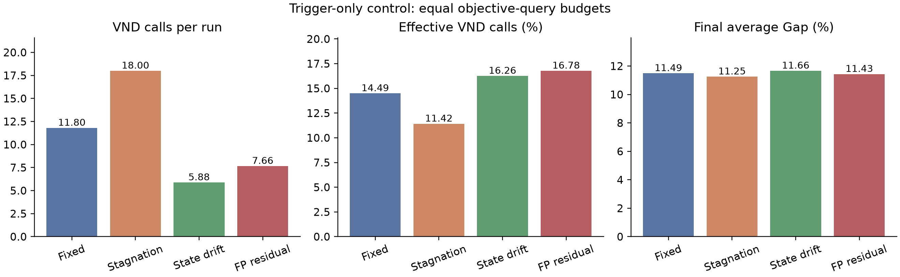
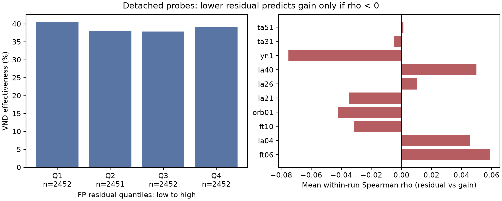

# FP 与简单触发器：受控实验报告

本报告是新增实验记录，不修改论文，也不使用先前存在 VND 强度混杂的试跑结果。

## 实验协议

- 实例：ft06, la04, ft10, orb01, la21, la26, la40, yn1, ta31, ta51；每实例 20 个配对种子。
- 每组总预算 30000 次目标函数查询（缓存命中也计数），VND 子预算上限 8000 次；实际解码次数另记。该预算不等同于墙钟时间。
- 种群 80，固定 GA 参数；每 10 代对最优个体执行相同 LS；每 5 代观测、85 代后开放触发、共同冷却 10 代。
- VND 对当前最优个体调用一次算一次；相同 max_iter=100，每次最多 500 次查询，严格改善才有效。所有组都使用截断时保留最好已评估解的相同封装。
- Fixed 每 20 代；Stagnation 最优值连续 15 代不改进；State Drift 同一归一化四维状态的一步加权 L2 差 ≤0.012；FP 使用可靠仿射算子残差 ≤0.012。
- FP 至少 16 个同间隔转移样本，拟合误差 ≤0.03，最多 48 个转移，ridge=1e-6；本实验隔离残差信号，不继承旧 Agent/阶段/停滞联合门控。
- 终局精化所有组统一关闭，避免终局 SA/VND 遮蔽触发收益；GA/LS 可消费剩余总预算，因此各组最终代数允许不同。
- 所有组计算相同观测量用于诊断，故时间包含 FP 观测开销，不能用该时间比较原生触发器的检测成本。初始化、各代 GA/LS/VND 使用配对且隔离的随机流。
- 阈值预先固定，未按最终排名重新调优；结果只适用于该协议，不证明算法不可替代。

## 主结果

| Trigger | VND调用总数 | 平均调用/运行 | 有效率 | 最终Avg Gap |
|---|---:|---:|---:|---:|
| fixed | 2360 | 11.80 | 14.49% | 11.488% |
| stagnation | 3600 | 18.00 | 11.42% | 11.253% |
| state_drift | 1175 | 5.88 | 16.26% | 11.664% |
| fp_residual | 1532 | 7.66 | 16.78% | 11.434% |

有效率 = 改善当前最优 makespan 的 VND 次数 / 实际 VND 调用次数。跨实例 Gap 等权平均；有效率用合计成功数除以合计调用数，不平均百分比。

## 配对比较

差值为 baseline − FP 的 Gap（百分点），正值才表示 FP 更好。95% 区间在实例、实例内配对种子两层重采样；p 值在实例均值层面做双侧精确符号翻转并进行三重 Holm 校正。

| 对照 | Gap差 | 95%区间 | Holm p | FP实例胜/平/负 |
|---|---:|---|---:|---|
| fixed | +0.055 | [-0.199, +0.350] | 0.6523 | [5, 0, 5] |
| stagnation | -0.181 | [-0.488, +0.112] | 0.4102 | [5, 0, 5] |
| state_drift | +0.230 | [-0.073, +0.551] | 0.3984 | [6, 0, 4] |

## 残差与调用收益：独立探测

额外 200 条 GA+LS 轨迹，在所有候选时刻进行不回写的 VND 探测；共 11200 个状态，其中 9807 个满足相同 FP 可靠性门槛。探测有独立随机流、缓存和预算，不计入四组部署预算，也不改变搜索轨迹。

相关性先在每条轨迹内计算，再在实例内、实例间等权平均。收益恒零或信号恒定的轨迹相关系数不可定义，单独报告，不能填成零或当成支持证据。区间基于实例重采样；状态不是独立实验单位。

| 信号 | 平均轨迹Spearman ρ | 实例Bootstrap 95%区间 | 有定义/无定义轨迹 |
|---|---:|---|---|
| fp_residual | -0.002 | [-0.028, +0.024] | 157/43 |
| state_drift | +0.010 | [-0.010, +0.031] | 157/43 |
| fitness_change | -0.009 | [-0.042, +0.020] | 109/91 |
| stagnant_generations | -0.020 | [-0.053, +0.011] | 157/43 |

下表在同一批可靠的中性轨迹状态上比较四种触发条件的选择准确性。Precision 是被选状态中 VND 有效的比例；Recall 是所有有效状态中被选中的比例。此处比较原始条件，不应用部署冷却或剩余预算门控；各阈值选择率不同，不能把它当成等调用次数对照。

| 条件 | 选择状态数 | Precision | Recall | 平均收益（Gap百分点） |
|---|---:|---:|---:|---:|
| fixed | 2311 | 39.46% | 23.91% | 0.4748 |
| stagnation | 8985 | 37.66% | 88.70% | 0.4550 |
| state_drift | 1482 | 39.47% | 15.33% | 0.5371 |
| fp_residual | 2300 | 40.43% | 24.38% | 0.5197 |

FP 假设要求残差与收益呈负相关。Spearman 是关联证据，不是因果证明；分桶图是描述性结果，阶段和实例仍可能影响关系。

## 结论与边界

FP 的平均 Gap 并非四组最低，当前实验不支持“FP 优于所有简单触发器”的主张。
残差—收益区间没有完全落在零以下，当前结果不足以确立“残差越小，VND 收益越高”。

这是固定单个查询预算下的触发器消融，不代表原完整 Agent-FP 的性能复现。需要更多预算点、阈值敏感性、独立验证实例和更强简单基线才能讨论稳健性；本次不追调阈值以制造胜出。

查询次数包含缓存命中，因此计算公平性限定为逻辑目标函数查询额度，不能等同于相同墙钟时间或完全相同真实解码工作量。summary.csv 同时列出实际解码次数。探测执行截断版 VND，结论不自动外推到无限制完整 VND。

## 复现

运行：OPENBLAS_NUM_THREADS=1 OMP_NUM_THREADS=1 python3 run_trigger_comparison.py --runs 20 --workers 4 --output results/trigger_controlled_20runs

分析：python3 analyze_trigger_comparison.py results/trigger_controlled_20runs

protocol.json 保存参数、种子规则所需基础种子、源码及实例文件哈希；逐实例逐种子 JSON 支持断点续跑；events.csv 保存逐次触发/探测日志，summary.csv 与 per_instance.csv 保存统计。
